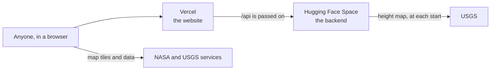

# Put Martian Map online for free

Two free services, each with one job:

| Part | Service | Cost | What it gives |
|---|---|---|---|
| The website (frontend) | **Vercel**, Hobby plan | Free | A fixed address that is always up |
| The calculator (backend) | **Hugging Face Spaces**, Docker Space on free CPU | Free | Runs our backend container as it is |



The website asks for `/api/...` on its own address. Vercel passes those requests on to the Space. So the app needs no change, and the browser never talks to the Space directly.

You need two free accounts: <https://huggingface.co/join> and <https://vercel.com/signup> (sign up to Vercel with your GitHub account, it is the easy way).

---

## Step 1. The backend, on Hugging Face

1. On Hugging Face, choose **New Space**.
   - Space name: `martian-map-api`
   - License: MIT · SDK: **Docker**, template **Blank** · Hardware: **CPU basic (free)** · Public
2. Build the folder to upload. In this project:
   ```bash
   bash deploy/make-space.sh
   ```
   It creates `deploy/space-build/` with four things: `Dockerfile`, `README.md`, `requirements.txt` and the `app` folder.
3. Put those files in the Space. The simple way: on the Space page open **Files**, then **Add file**, then **Upload files**, drag in everything that is inside `deploy/space-build/`, and commit.
4. The Space builds for a few minutes. When it says **Running**, open:
   ```
   https://YOUR-HF-NAME-martian-map-api.hf.space/api/health
   ```
   It must answer `{"status":"ok", ...}`. `YOUR-HF-NAME` is your Hugging Face user name.
5. Check the height map is ready (give it some seconds after the start):
   ```
   https://YOUR-HF-NAME-martian-map-api.hf.space/api/dem/info
   ```
   `"status"` must be `"ready"`.

## Step 2. Tell the website where the backend is

Open `frontend/vercel.json` and replace `YOUR-HF-NAME` in the `destination` line with your Hugging Face user name. Commit and push.

## Step 3. The website, on Vercel

1. On Vercel choose **Add New**, then **Project**, and import the GitHub repository `Nasa-Challenge-Martian-Map`.
2. Set **Root Directory** to `frontend`. Everything else is read from `frontend/vercel.json`.
3. Press **Deploy**. After a minute or two you get an address like `https://nasa-challenge-martian-map.vercel.app`.
4. Open it, go to the map, open **Route** and pick two places. If routes appear, the two parts talk to each other.

From then on, every push to `main` updates the website by itself.

---

## Things to know

- **The backend sleeps.** A free Space stops after a time with no visitors. The next visit wakes it up, which takes about a minute: during that time the map works but heights and routes say the server cannot be reached. Open the site a few minutes before a demo.
- **After a backend change**, run `bash deploy/make-space.sh` again and upload the files again. The Space does not follow GitHub by itself.
- **Free plans change.** These steps were written on 2026-11-15 and were not run end to end by us: the two accounts are yours to create. Check each service's current free limits before relying on it.
- **The link from your own computer** (the Cloudflare tunnel in the README) still works and needs no account. It is the fallback.
