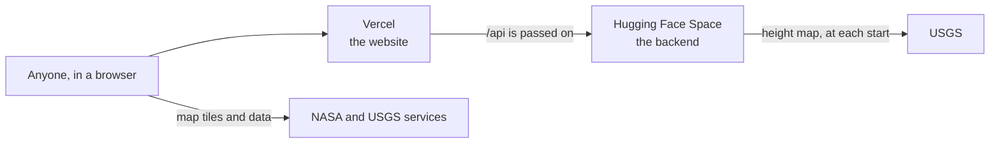

# Put Martian Map online for free

Two free services, each with one job. Neither asks for a credit card.

| Part | Service | What it gives |
|---|---|---|
| The website (frontend) | **Vercel**, Hobby plan | A fixed address that is always up |
| The calculator (backend) | **Hugging Face Space**, Gradio, free hardware | Runs our backend inside a small Gradio app |



The website asks for `/api/...` on its own address. Vercel passes those requests on to the Space. So the app needs no change, and the browser never talks to the Space directly.

**Why a Gradio Space.** Hugging Face runs Docker Spaces on paid hardware only (seen on 2026-11-15). A Gradio Space is free. So `deploy/huggingface-gradio/app.py` starts our normal backend inside a Gradio app: the API still answers under `/api`, and the front address shows a short page about it.

---

## Step 1. The backend, on Hugging Face

1. On Hugging Face choose **New Space**.
   - Space name: `martian-map-api`
   - SDK: **Gradio**, template **Blank**
   - Hardware: the one marked **Free**
   - Public
2. Build the folder to upload. In this project:
   ```bash
   bash deploy/make-space.sh
   ```
   It creates `deploy/space-build/` with four things: `app.py`, `requirements.txt`, `packages.txt` and the folder `mapapi`.
3. On the Space page open **Files**, then **Add file**, then **Upload files**. Drag in everything that is inside `deploy/space-build/` (the three files and the `mapapi` folder) and commit.
   - Keep the `README.md` that Hugging Face made. Do not replace it.
   - If the Space already has an `app.py`, ours replaces it.
4. The Space builds for a few minutes. When it says **Running**, open this address (with your Hugging Face name in place of `YOUR-HF-NAME`):
   ```
   https://YOUR-HF-NAME-martian-map-api.hf.space/api/health
   ```
   It must answer `{"status":"ok", ...}`.
5. A few seconds later, check the height map:
   ```
   https://YOUR-HF-NAME-martian-map-api.hf.space/api/dem/info
   ```
   `"status"` must be `"ready"`.

## Step 2. Tell the website where the backend is

Open `frontend/vercel.json`. In the `destination` line put the address of your Space, like this:

```
"destination": "https://YOUR-HF-NAME-martian-map-api.hf.space/api/:path*"
```

Commit and push.

## Step 3. The website, on Vercel

1. On Vercel choose **Add New**, then **Project**, and import the GitHub repository `Nasa-Challenge-Martian-Map`.
2. Set **Root Directory** to `frontend`. Everything else is read from `frontend/vercel.json`.
3. Press **Deploy**. After a minute or two you get an address like `https://nasa-challenge-martian-map.vercel.app`.
4. Open it, go to the map, open **Route** and pick two places. If routes appear, the two parts talk to each other.

From then on, every push to `main` updates the website by itself.

---

## What was tested, and what was not

- **Tested on the developer's computer:** the content of `deploy/space-build/` with the newest Gradio (6.32). It starts, downloads the height map, and answers `/api/health`, `/api/point`, `/api/routes` and `/api/reach`. It used about 385 MB of memory.
- **Not tested:** the two services themselves. The first real run is yours.

## Things to know

- **The backend sleeps.** A free Space stops after a time with no visitors. The next visit wakes it up, which can take a minute or two. During that time the map works, but heights and routes say the server cannot be reached. Open the site a few minutes before a demo.
- **Long routes use the simpler search.** To stay small in memory, the Space uses the direction-aware "Fastest" search only for short routes. The answer says which search was used.
- **After a backend change**, run `bash deploy/make-space.sh` again and upload the files again. The Space does not follow GitHub by itself.
- **Free plans change.** Hugging Face moved Docker Spaces to paid hardware while we were building this. Check each service's current free limits before relying on it.
- **Another free host for the backend:** `render.yaml` is ready for Render's free web service (512 MB of memory, sleeps after 15 minutes). Not tested by us.
- **The link from your own computer** (the Cloudflare tunnel in the README) still works and needs no account. It is the fallback.
