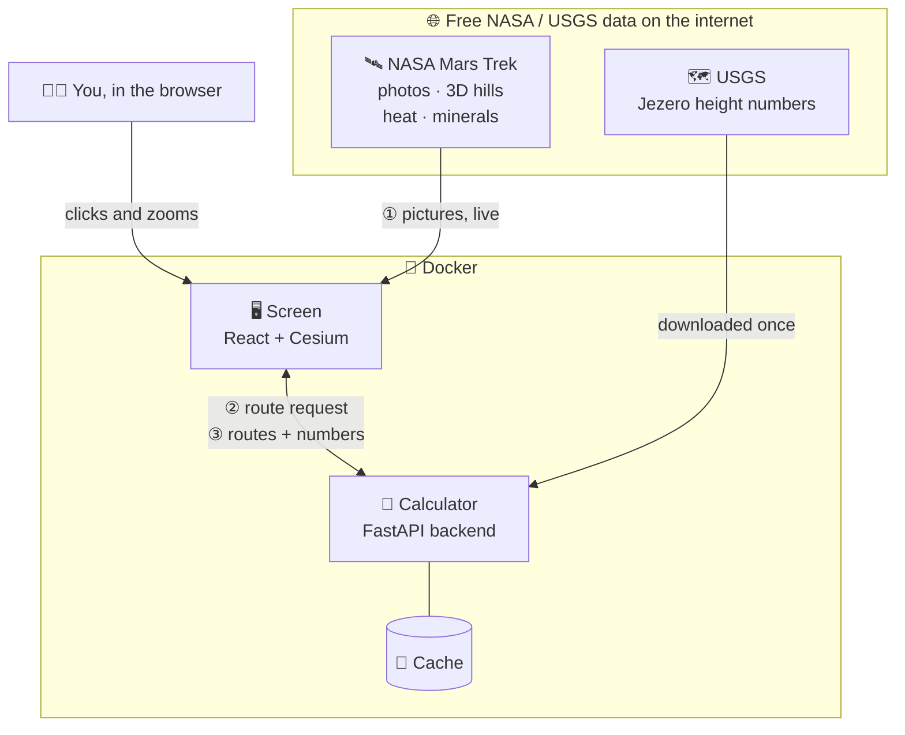
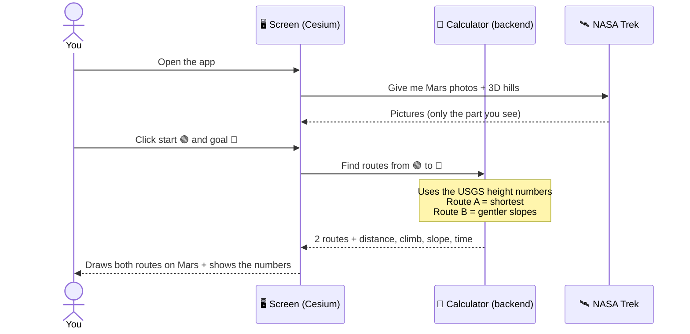
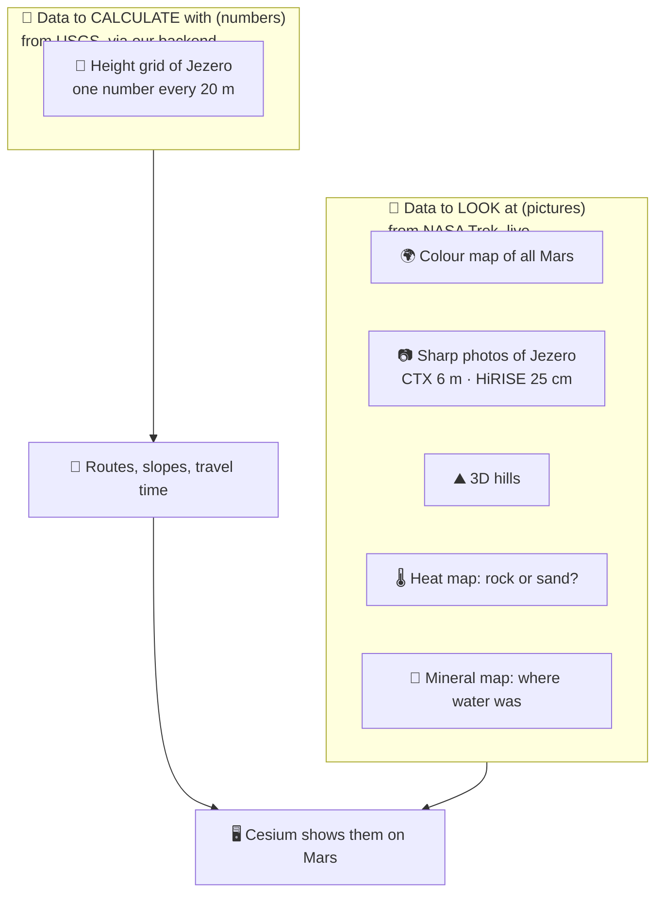
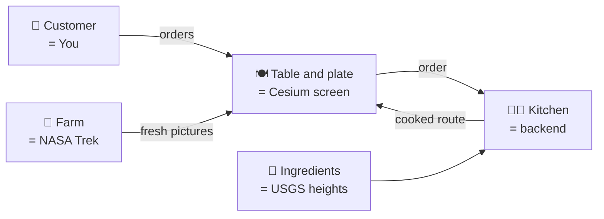
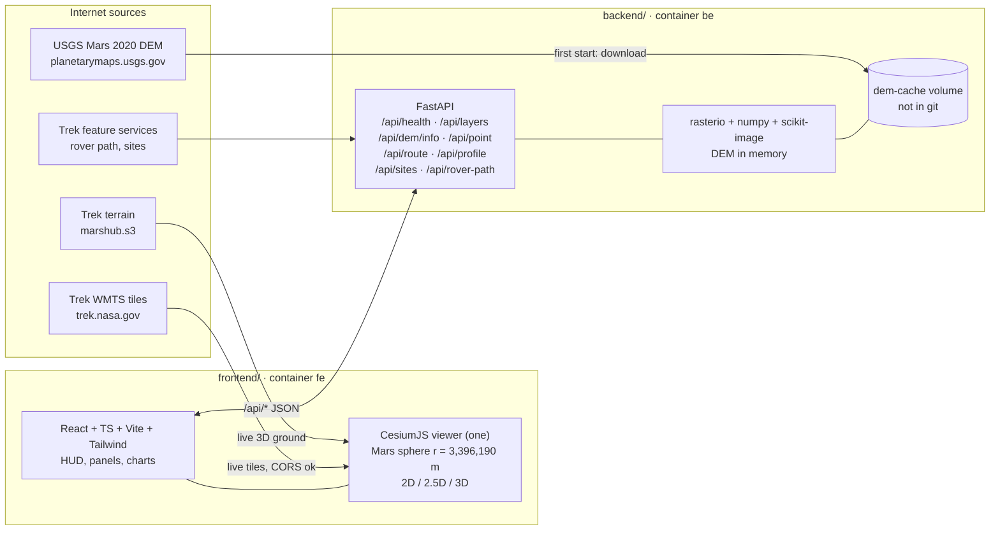

# Martian Map: Mars Exploration and Marswalk Planner

**NASA Space Apps 2026 · Challenge: Interplanetary Survival Guide: Martian Map**
**Deadline:** Sunday 19:00 · **Team:** 1 developer + AI · **Status:** 📝 Planning (no code yet)

> **In one sentence:** a website where you fly from space into **Jezero Crater** on Mars, look at real NASA maps in 2D, 2.5D and 3D, and compare two walking routes for an astronaut: the **shortest** route and a route with **gentler slopes**.
>
> This is a **study and planning tool**. It is **not** a real navigation system for astronauts.

---

## Contents

1. [Mars data for beginners](#1-mars-data-for-beginners)
2. [What the challenge asks](#2-what-the-challenge-asks)
3. [What the user can do](#3-what-the-user-can-do)
4. [Our decisions and the trade-offs](#4-our-decisions-and-the-trade-offs)
5. [How the system works (architecture)](#5-how-the-system-works-architecture)
6. [The data we use (checked live)](#6-the-data-we-use-checked-live)
7. [Map layers (the GIS part)](#7-map-layers-the-gis-part)
8. [How routes are made](#8-how-routes-are-made)
9. [Look and feel](#9-look-and-feel)
10. [Folder structure](#10-folder-structure)
11. [Build plan (milestones)](#11-build-plan-milestones)
12. [Risks and backup plans](#12-risks-and-backup-plans)
13. [Open questions](#13-open-questions)

---

## 1. Mars data for beginners

You don't need to be a Mars expert. These are the words you will see in this project.

### 1.1 Two kinds of map data

| Kind | What it is | Example | Can we calculate with it? |
|---|---|---|---|
| **Image** (imagery) | A photo of the ground taken from space. Every pixel is a colour. | CTX photo of Jezero | ❌ No. You can only *look* at it |
| **Elevation** (DEM = Digital Elevation Model) | A grid of numbers. Every cell is a **height in metres**. | CTX DEM of Jezero (one height every 20 m) | ✅ Yes. We get slope, distance and climbing from it |

> ⚠️ **Common mistake:** a "hillshade" or "shaded relief" map *looks* like 3D, but it is only an image. For routes we need the real **numbers** (the DEM).

### 1.2 Resolution: how sharp the data is

**Resolution** = how big one pixel or cell is on the ground. A smaller number means more detail.

| Resolution | What you can see | Example |
|---|---|---|
| 463 m | Big mountains and craters | MOLA (whole planet) |
| 232 m | Large landforms | Viking colour map (whole planet) |
| 100 m | Thermal patterns | THEMIS (whole planet) |
| 20 m | Hills, crater walls | CTX DEM (Jezero) |
| 6 m | Small craters, dunes | CTX image (Jezero) |
| 1 m | Single boulders on a slope | HiRISE DEM (part of Jezero) |
| 25 cm | Rocks the size of a chair | HiRISE image (part of Jezero) |

**Trade-off:** sharper data means much bigger files. That is why we use sharp data only for Jezero, not for the whole planet.

### 1.3 The spacecraft and instruments (where the data comes from)

| Name | Spacecraft | What it measures | We use it for |
|---|---|---|---|
| **Viking** | Viking orbiters (1970s) | Colour photos of the whole planet | The globe in the intro |
| **MOLA** | Mars Global Surveyor | Laser heights of the whole planet | (Background terrain, inside Trek) |
| **CTX** | Mars Reconnaissance Orbiter (MRO) | Black-and-white photos, 6 m. Two photos together make a DEM (stereo) | Jezero image + **our routing DEM** |
| **HiRISE** | MRO | The sharpest camera at Mars (25 cm) | Close-up Jezero image |
| **THEMIS** | Mars Odyssey | Heat (infrared), day and night | **Thermal layer**: rock or sand? |
| **CRISM** | MRO | Light spectrum → which **minerals** are there | **Spectral layer**: science targets |
| **Perseverance** | NASA rover in Jezero since 2021 | Drives, photos, samples | Real rover path on our map |

### 1.4 Why thermal data helps an astronaut

At night, **rock stays warm for longer**. **Dust and sand cool down fast**.
So on a THEMIS **night** map: bright means rocky ground (harder to walk on, more boulders), and dark means fine sand or dust (soft, can be slippery).
This is a **hint**, not proof. The resolution is 100 m.

### 1.5 Why mineral (spectral) data helps science

Jezero was a **lake with a river delta** about 3.5 billion years ago. CRISM shows **carbonates and clays**. These minerals form in water, so they are the best places to look for signs of ancient life. That is why Perseverance went there, and they make good **science destinations** for our astronaut.

### 1.6 Map words

| Word | Simple meaning |
|---|---|
| **Projection** | A way to draw a round planet on a flat screen. Trek uses "Equirectangular": longitude goes left to right, latitude goes bottom to top, as a simple grid. |
| **EPSG:104905** | The code name for "Mars, latitude/longitude, sphere 3,396,190 m". Trek uses this. |
| **Ellipsoid / sphere** | The mathematical shape of the planet. A sphere is a perfect ball. An ellipsoid is a ball that is a little flat at the poles. **The data and the map engine must use the same shape**, or everything moves a few km. |
| **Areoid** | The "sea level" of Mars (Mars has no sea, so it is a mathematical surface). Heights in our DEM are measured from it, so the Jezero floor is about −2,500 m. |
| **Tiles / WMTS** | Big maps are cut into small square pictures (tiles). The browser downloads only the tiles you look at. WMTS is the standard way to ask a server for tiles. |
| **Quantized-mesh** | Cesium's format for 3D terrain tiles. |
| **CORS** | A browser security rule. A website can load data from another server only if that server allows it. ✅ We checked: Trek allows it. |
| **GeoTIFF** | An image file that also stores map coordinates. DEM files usually come as GeoTIFF. |
| **GDAL** | A free tool to read, cut and convert map files. We use it once, before the app runs. |
| **Slope** | How steep the ground is, in degrees. 0° is flat, 30° is very steep for walking in a spacesuit. |

---

## 2. What the challenge asks

Source: [challenge details](https://www.spaceappschallenge.org/2026/challenges/interplanetary-survival-guide-martian-map/?tab=details) · [resources](https://www.spaceappschallenge.org/2026/challenges/interplanetary-survival-guide-martian-map/?tab=resources)

| The challenge says… | Our answer |
|---|---|
| Make a map/tool an astronaut could use on a Mars surface mission, with NASA data | A mission-planning screen (HUD) for a walk in Jezero |
| Trek and USGS show global/regional views. Astronauts need **very local** detail | Jezero at 6 m and 25 cm images + 20 m elevation grid |
| Start with **science goals** and pick places for them | Ready-made science destinations (delta, carbonate areas…) |
| Use **at least 3 kinds of data** together | **Optical** (photos) + **Topographic** (heights, slope) + **Thermal** (THEMIS) + **Spectral** (CRISM) = 4 |
| **Safety first**: avoid obstacles | Slope limits, blocked cells, warnings, thermal "rocky ground" hint |
| Spacesuits and heavy equipment slow people down | Travel time with suit and load factors |
| *(Optional)* HUD, tablet or helmet display | Mission-control HUD style |
| *(Optional)* Rovers, or astronauts in pairs | "Walk vs rover" travel time |
| *(Optional)* Photos from the ground | *Extra if time allows:* Perseverance photos near a point |

---

## 3. What the user can do

| Level | What happens | Data |
|---|---|---|
| **1. Intro (globe)** | A short movie-like opening (5–10 s): space → Mars → fly down into Jezero. There is a "Skip" button. The globe is a **wow moment**, not the main work area. | Viking colour map + Trek terrain |
| **2. Jezero (main stage)** | Sharp images, real 3D ground, layers on/off, height under the mouse, **switch 2D / 2.5D / 3D** | CTX, HiRISE, THEMIS, CRISM, Trek terrain, Perseverance path |
| **3. Marswalk** | Choose a start and a science destination, then see **Route A (shortest)** and **Route B (gentler slopes)** with numbers, a height chart and warnings | USGS CTX DEM (20 m) |

### View modes (one button)

| Mode | Looks like | Good for |
|---|---|---|
| **2D** | Flat map from above, like Trek | Reading routes clearly. Fast on weak computers |
| **2.5D** | The flat map tilted, with hills that stand up | Seeing the ground shape while keeping the "map" feeling |
| **3D** | The real round planet. Very close, it looks like a 3D landscape | The intro and an immersive view |

---

## 4. Our decisions and the trade-offs

Every decision has a **cost**. This section shows what we chose, what we gave up and why.
Legend: ✅ chosen · ❌ rejected · ⚠️ needs a test

### D1. Do we show the whole planet?

| Option | Good | Bad |
|---|---|---|
| ✅ **Globe only as a short intro** | Big "wow" for judges. Almost free in Cesium | Small extra work for the fly-in animation |
| Globe as a full exploration area | Feels like Google Earth | Takes time away from Jezero, where the real value is |
| No globe at all | Simplest | Loses the "we are on Mars" feeling |

**Why:** the judges want local detail for astronauts. The globe only sets the scene.

### D2. Where do the map images come from?

| Option | Good | Bad |
|---|---|---|
| ✅ **Load live from NASA Mars Trek** | Zero preparation. Official NASA data. Many layers. CORS allowed ✅ | If Trek is slow or down, our map is too |
| Download and host the images ourselves | Full control. Works offline | Hours of tile-making. Big files. Less time for features |

**Why:** with 24 hours, we can't spend hours making tiles. **What we give up:** full control. **Backup:** a screen recording of the demo, in case Trek is down during judging.

### D3. Where does the 3D ground come from (for display)?

| Option | Good | Bad |
|---|---|---|
| ✅ **Trek's own terrain service** (`marshub…/layer.json`) | Whole planet, very sharp at Jezero (down to ~1–2 m). Same data Trek uses. Free | Not a documented public API, so it could change |
| Make our own terrain tiles from the DEM | Full control | Many hours. The tools are made for Earth |
| Cesium "Mars" (Cesium ion) | Beautiful | Needs an account key. **Does not work in 2D.** Imagery is "baked in", so we can't add our layers on top. Jezero only 20 m |

**Why:** best quality for zero work. **Backup:** smooth sphere + our own Jezero DEM shown with Cesium's `CustomHeightmapTerrainProvider`.

### D0. APIs only, a frontend and a backend, Docker (team decision, 2026-11-14)

| Option | Good | Bad |
|---|---|---|
| Static website, data files inside the project | Simplest hosting | Data files in our repo. All calculation in the browser |
| ✅ **Frontend + backend, all data from NASA/USGS APIs, run with Docker** | **No data stored in our repo.** Real GIS tools (GDAL, rasterio, numpy) on the server. Clean API for the frontend. One command to run: `docker compose up` | Hosting a backend needs a container host (or demo locally). A little more setup |

**Rules that follow from this:**
- The repo holds **code only**. No `.tif`, no `.bin`, no tiles.
- Map images and 3D ground: the **frontend** reads them **directly from Trek** (no need to go through our server; CORS is open ✅).
- Elevation numbers: the **backend** reads the USGS DEM **from its public URL** when it starts and keeps a copy in a **Docker cache volume** (outside git). Delete the volume, and it downloads again.
- Routes, slope, elevation profile and point info: **calculated by the backend**, served as JSON.

### D4. Which elevation numbers do we use for routes?

| Option | Size | Good | Bad |
|---|---|---|---|
| MOLA (463 m) | Large global file | Whole planet | Too rough: one value per ~half a kilometre |
| ✅ **CTX DEM (20 m)** | **9.7 MB** | Covers the whole crater area (~30 × 30 km). Small. Official Mars 2020 landing data | Small cliffs and rocks are smoothed away |
| HiRISE DEM (1 m) | 72–125 MB *per piece* | Very sharp | Too big for the browser. Covers only parts |

**Why:** the best balance between detail and speed. **What we give up:** small obstacles. We **say this clearly in the app** ("slopes calculated at 20 m").

### D5. Which map engine?

| | **CesiumJS** ✅ | deck.gl | MapLibre | Three.js / R3F | MMGIS |
|---|---|---|---|---|---|
| What it is | 3D globe + GIS engine | Data-drawing layers | Map engine (mostly 2D) | General 3D toolkit | NASA's mission GIS app |
| Mars shape | ✅ Any shape | ❌ Earth maths inside | ❌ Earth size fixed | 🛠 Build it yourself | ✅ |
| 2D / 2.5D / 3D switch | ✅ Built in | Partial | 2D + tilt | 🛠 Build it | 2D and 3D are separate panels |
| Trek images (EPSG:104905) | ✅ Native | ⚠️ Wants Web Mercator | ⚠️ Wants Web Mercator | 🛠 | ✅ |
| Trek 3D terrain | ✅ Native format | ❌ | ❌ | 🛠 | ✅ |
| Drawing data (lines, points) | ✅ Good | ✅✅ Best | ✅ Good | 🛠 Manual | ✅ |
| Needs a server | No | No | No | No | ❌ Yes (Node + Postgres) |
| Work for us in 24 h | **Low–medium** | High | High | Very high | Medium, breaks "no server" |
| Used by NASA for Mars | ✅ **Mars Trek is built on Cesium** | — | — | — | ✅ |

**Why Cesium:** it is the only option that supports the Mars shape, Trek data and the 2D/2.5D/3D switch out of the box. NASA uses it for Trek.

**Why not deck.gl:** deck.gl is great for drawing *huge* amounts of data (millions of points, heatmaps). But it is built for Earth (Web Mercator), so on Mars we'd fake coordinates, and it can't read Trek terrain. Using it *with* Cesium means two engines on one screen. Our data is small (2 routes, some sites, some image layers), so Cesium is enough.

**What we give up with Cesium:** a bigger library (~3–4 MB) and fewer "fancy" effects than custom Three.js shaders.

### D6. One viewer or two?

| Option | Good | Bad |
|---|---|---|
| ✅ **One Cesium viewer for everything** | One camera, one set of layers, routes shown the same everywhere | Must test Mars in 2D/2.5D ⚠️ |
| Globe viewer + separate Jezero viewer (e.g. Three.js) | Full control of the local scene | Two engines, camera sync, double work |

**Why:** less code, fewer bugs, and a smoother experience (no "jump" between screens).

### D7. What shape is Mars in the engine?

| Option | Good | Bad |
|---|---|---|
| ✅ **Perfect sphere, radius 3,396,190 m** | **Same as all Trek and USGS data** | None for us |
| Cesium's built-in `Ellipsoid.MARS` (flat at the poles) | Ready to use | Doesn't match the data. Places would move by ~10 km at Jezero |

**Why:** data and engine must use the same shape. ⚠️ We test it in M0 by checking the Perseverance landing site.

### D8. How do we connect Cesium to React?

| Option | Good | Bad |
|---|---|---|
| ✅ **Plain Cesium inside one React component** | Full control, no extra layer, easy to debug, all examples work | A little manual setup code |
| Resium (React wrapper for Cesium) | "React style" code | Another library to learn. Most examples online are plain Cesium |

### D9. Which route algorithm, and where does it run?

| Option | Good | Bad |
|---|---|---|
| Dijkstra | Always finds the best route | Slower: searches in every direction |
| ✅ **A\*** | Same best route, **much faster** (it searches toward the goal) | Routes on a grid can zigzag a little |
| Theta\* | Straighter, nicer lines | More complex. Maybe later |

| Where it runs | Good | Bad |
|---|---|---|
| In the browser (Web Worker) | No server | DEM file must be in the frontend. Hand-written A\* in JavaScript |
| ✅ **On our backend (Python)** | Uses tested GIS libraries. DEM stays on the server. Same answer for every user. Easy to test with numbers | Needs the backend running |
| Pre-calculated routes only | Very simple | User can't choose points. Weak demo |

**Which library on the backend:**

| Option | Good | Bad |
|---|---|---|
| Hand-written A\* in pure Python | Easy to read | Slow in Python on ~2 M cells (seconds or more) |
| ✅ **scikit-image `MCP_Geometric`** (minimum-cost path, written in fast C code) | Fast, well tested, used in science. Handles diagonal steps with the correct √2 length | Works with a *cost per cell* (not per step). That fits our costs well, see section 8 |

`MCP` finds the same best path as Dijkstra/A\* (guaranteed lowest total cost). We keep the word "A\*-style least-cost path" out of the UI and say "least-cost path".

### D10. What does "shortest" and "better" mean?

| Route | Cost of each step | Meaning |
|---|---|---|
| **A: Shortest** | Real walking distance on the ground (includes up and down) | The shortest walk |
| **B: Gentler slopes** | Walking distance × a penalty that grows with steepness | Longer, but avoids steep ground |

We **never** call Route B "safest". Slope is only one danger. Rocks, sand, dust and light are not fully modelled.

### D11. How do we draw routes on the 3D ground?

| Option | Good | Bad |
|---|---|---|
| "Clamp to ground" (Cesium sticks the line to the terrain) | Easy | Known problems on non-Earth planets |
| ✅ **Sample the Trek terrain height for every route point** (Cesium `sampleTerrainMostDetailed`) | The line sits exactly on the 3D ground we show, in 2D, 2.5D and 3D | A little extra code. **Numbers** still come from the USGS DEM (Trek terrain uses a different height zero, see section 12) |

### D12. Can we reuse other projects?

| Project | Decision | Why |
|---|---|---|
| **MONOLITH** (Three.js terrain) | 💡 **Ideas only** | MIT licence, nice look. But Earth data, flat area only, one 1,000-line file. We rebuild its look in Cesium (contours, colours, camera tour) |
| **ByteLounge / NASA-space-apps** | ❌ **Avoid** | Another team's entry for this challenge, no licence. Its "real MOLA data" is **fake** (made with sine waves) |
| **MMGIS** (NASA) | 💡 **Ideas only** | Real NASA tool, but needs a server + database. Idea we take: 16-direction grid moves for smoother routes |
| **Cesium Mars (ion)** | ❌ **Skip** | No 2D, needs a key, can't add layers on top |
| **deck.gl** | ❌ **Skip** | See D5 |

### D13. Where do we host it?

| Option | Good | Bad |
|---|---|---|
| Static website only | Free and simple | No backend (does not fit D0) |
| ✅ **Docker Compose (frontend + backend)** | Same setup on every computer. One command. Works offline after the first DEM download | Needs Docker |
| Public link for judges | Frontend on Vercel + backend container on a free host (Render / Fly.io / Railway) | Extra 30–60 min in M7. ⚠️ Decide in M7 |

### D14. Travel time

| Option | Good | Bad |
|---|---|---|
| No travel time | Nothing to defend | Weaker for an astronaut tool |
| Earth walking formula only | Simple | Wrong gravity |
| ✅ **Mars-gravity walking model + suit/load factors + rover option, labelled "estimate"** | Uses real physics (gravity) and answers the challenge (suits, equipment, rovers) | Some numbers are assumptions, so we show them openly |

---

## 5. How the system works (architecture)

### 5.1 In simple pictures

**The three parts:** Screen = **Cesium** (draws Mars) · Pictures = **NASA Trek** (live, nothing stored) · Calculator = **our backend** (uses USGS height numbers).



**How to read it:** ① the screen gets Mars pictures straight from NASA Trek. ② When you ask for a route, the screen asks the calculator. ③ The calculator answers with 2 routes and their numbers. It uses the USGS heights, downloaded once and kept in the cache.

**What happens when you ask for a route:**



**Two kinds of data:**



**Think of a restaurant:**



### 5.2 Technical view



**Why images go straight from the browser to Trek:** tiles are many small requests. Sending them through our backend would make the map slower and add nothing. Trek allows it (CORS ✅).
**Why calculations go through the backend:** real GIS libraries, the DEM stays on the server, results are testable.

**Stack summary**

| Part | Tool | Why |
|---|---|---|
| UI | React + TypeScript + Vite | Fast setup, type safety, AI writes it well |
| Styling | Tailwind (+ shadcn/ui for panels) | Fast, consistent HUD look |
| Animation | Motion (UI) + GSAP (timelines) | See skill `demo-motion` |
| Map engine | CesiumJS (plain) | See D5 |
| State | React state (Zustand only if needed) | Keep it simple |
| Height chart | A small chart library (Recharts) or plain SVG | Elevation profile |
| Backend | **Python 3.12 + FastAPI** | Fast to write, automatic API docs at `/docs` |
| GIS on backend | **rasterio** (GDAL inside), **numpy**, **scikit-image** (`MCP_Geometric`) | Standard, tested science tools |
| Run everything | **Docker Compose** (`fe` + `be` + cache volume) | One command, same on every machine |
| Version control | Git | See changes over time |

---

## 6. The data we use (checked live)

All addresses below were checked on 2026-11-14.

### 6.1 Shown on the map (streamed live from NASA)

| Layer | Type | Address / Trek layer name | Notes |
|---|---|---|---|
| Global colour | Optical | `Mars_Viking_MDIM21_ClrMosaic_global_232m` | 232 m, whole planet |
| **Jezero region CTX, aligned (~6 m)** | Optical | Trek `Jezero_CTX_BlockAdj_dd` (block-adjusted: strips aligned to each other) | **Main Jezero layer.** 75.2–78.9°E, 15.9–19.4°N |
| **Global CTX (~5 m)** | Optical | `https://astro.arcgis.com/arcgis/rest/services/OnMars/CTX/MapServer/tile/{z}/{y}/{x}` (Caltech Murray Lab / Esri, 512 px tiles, Mars 2000 sphere, CORS ✅) | Rest of Mars. "Uncontrolled": strips can shift at seams (a crater looked cut), so the aligned mosaic is used over Jezero |
| Jezero CTX | Optical | `JEZ_ctx_B_soc_008_orthoMosaic_6m_Eqc_latTs0_lon0` | 6 m. Area 77.16–77.70°E, 18.21–18.72°N |
| Jezero HiRISE | Optical | `JEZ_hirise_soc_006_orthoMosaic_25cm_Eqc_latTs0_lon0_first_dd` | 25 cm, centre of the crater |
| 3D ground | Topographic | `https://marshub.s3.amazonaws.com/mars_v14/layer.json` | Whole planet, very sharp at Jezero ⚠️ undocumented |
| Night heat | **Thermal** | `THEMIS_NightIR_ControlledMosaics_100m_v2_oct2018` | 100 m. Bright = rocky, dark = sand/dust |
| Minerals | **Spectral** | CRISM e.g. `frt_07_brcarj_mtr3_ll` (carbonates), `frt_07_brmafj_mtr3_ll` (olivine), `frt_07_brphyj_mtr3_ll` (clays) | ⚠️ coverage to check by eye |
| Geology | Context | `SIM3292_Global_Geology` (USGS-NASA geologic map) | Regional |
| Rover path | Vector | `trek.nasa.gov/mars/trekarcgis/rest/services/Perseverance_Traverse_Path/MapServer/0` | Real Perseverance drives |
| Science places | Vector | Trek bookmark "Jezero Crater Features and Landforms" | Has waypoints |

- Tile address pattern: `https://trek.nasa.gov/tiles/Mars/EQ/<LAYER>/1.0.0/WMTSCapabilities.xml`
- Find more layers: `https://trek.nasa.gov/mars/TrekServices/ws/index/eq/searchItems?key=<word>&proj=urn:ogc:def:crs:EPSG::104905`, then `getLayerServices?uuid=<id>`

### 6.2 Used for calculations (downloaded once)

The backend reads this file **from its public URL** at start-up and caches it in a Docker volume. It is **never** put in git.

| File | From | Size | Use |
|---|---|---|---|
| `JEZ_ctx_B_soc_008_DTM_MOLAtopography_DeltaGeoid_20m_Eqc_latTs0_lon0.tif` | USGS Mars 2020 landing data: `https://planetarymaps.usgs.gov/mosaic/mars2020_trn/CTX/` | 9.7 MB | **Routing grid** |
| HiRISE DTM 1 m (several pieces) | same site, `/HiRISE/` | 72–125 MB each | Maybe a small sharp area later |

- **Map shape:** Equirectangular on the Mars sphere (3,396,190 m), the same as Trek ✅
- **Heights:** measured from the Mars "sea level" (areoid). ⚠️ To confirm from the file's metadata
- **Size of the grid:** ~30 × 30 km ÷ 20 m ≈ 1500 × 1500 cells. OK for the browser

---

## 7. Map layers (the GIS part)

All layers are written in **one settings file**. The layer panel is built from it, so adding a new NASA layer = adding one entry.

```ts
// Shape only, not final code
{ id: 'themis-night', title: 'Thermal: THEMIS Night IR', category: 'thermal',
  source: 'trek-wmts', layerId: 'THEMIS_NightIR_ControlledMosaics_100m_v2_oct2018',
  defaultOpacity: 0.6, visible: false, legend: 'Bright = rock · Dark = dust/sand' }
```

| Category | Layers | Cesium tool |
|---|---|---|
| Optical | Viking, CTX, HiRISE | `ImageryLayer` (WMTS) |
| Topographic | 3D ground, contours, height colours, slope colours | Terrain provider + globe `Material` |
| Thermal | THEMIS night | `ImageryLayer` + transparency |
| Spectral | CRISM minerals | `ImageryLayer` + transparency |
| Vector | Rover path, science sites, our routes | `GeoJsonDataSource`, `Entity` |

**Nice and cheap features:**
- **Transparency slider** for every layer.
- **Swipe compare:** drag a bar to compare two layers side by side, e.g. photo vs heat.
- **Coloured category chips** (Optical / Topo / Thermal / Spectral). Judges see "4 data types" at once.
- **Click on any point** → height, slope, heat value and coordinates in the HUD.

---

## 8. How routes are made

NASA does **not** give a public "route from A to B" tool for Mars. We build it with a standard method from robotics and GIS.

```
1. Height grid          2. Slope per cell         3. Grid becomes a network    4. A* finds the cheapest path
┌────┬────┬────┐        ┌───┬───┬───┐            each cell connects to        start ●
│-2.1│-2.0│-1.8│ km     │ 3°│ 5°│12°│            its 8 (later 16) neighbours     ╲
├────┼────┼────┤   →    ├───┼───┼───┤     →      each step has a cost      →      ╲__
│-2.2│-2.1│-1.5│        │ 2°│ 9°│28°│                                                ╲ ● goal
└────┴────┴────┘        └───┴───┴───┘
```

**Steps (all on the backend)**
1. **Load (at start-up):** download the USGS DEM once (cached), read it with rasterio, mark missing cells, keep the grid in memory.
2. **Slope:** for each cell, use the neighbour heights and real distances in metres (the Horn method, the same as GDAL's `gdaldem slope`). Calculated once at start-up.
3. **Cost grid:** one cost value per cell (see the table).
4. **Least-cost path:** `scikit-image MCP_Geometric` finds the path with the lowest total cost. It already counts diagonal steps as √2 longer. Run it twice, once per cost grid.
5. **Answer:** points (longitude, latitude, height) + statistics, as JSON to the frontend.

| Route | Cost per cell (× step length) | Meaning | Blocked cells |
|---|---|---|---|
| **A: Shortest** | `1 / cos(slope)` | Turns flat distance into **real ground distance** (a 30° slope is 15% longer to walk) | Missing data, slope > 30° |
| **B: Gentler** | `1 / cos(slope) × (1 + (slope ÷ 10°)²)` | Same, plus a penalty that grows fast with steepness | Missing data, slope > 25° |

> The numbers 25°, 30° and 10° are **settings**. We show them in the app and explain them. They are not "secret magic numbers".
> *Optional extra:* add a small extra cost for "rocky" ground from the THEMIS night layer.

**What we show for each route:** distance · total climb and descent · highest and average slope · % of the route steeper than 15° · estimated time · height chart (profile) · warnings.

**Travel time (estimate, clearly labelled)**
- Walking speed depends on gravity. Mars gravity is 3.71 m/s² (38% of Earth). Physics (the "Froude number") gives a comfortable speed of about **0.9 m/s** for a person without a suit.
- × **suit factor** (assumption, e.g. 0.6) × **load factor** (equipment) × **slope factor** (slower uphill and steep downhill).
- **Rover option:** Perseverance's top speed is about 152 m/hour.

---

## 9. Look and feel

**Decision (2026-11-14): Option C, a clean NASA website style.**

| Option | Good | Bad |
|---|---|---|
| A. Dark mission control (MONOLITH) | Dramatic, high-tech | Small text on dark needs care |
| B. Astronaut helmet HUD | Big "wow" | Hard to read, more design work |
| ✅ **C. Clean NASA website** | **Easy to read, fast to build, looks official** | Less "wow". The Mars map must carry the visual impact |

**Style rules**
- **Colours:** white and light grey panels, **NASA blue `#0B3D91`** for headers and main buttons, **NASA red `#FC3D21`** only for alerts and the active route. Dark grey text `#1F2937`.
- **Font:** Inter (or the system font). Numbers use tabular figures so they don't jump.
- **Layout:** a top bar (title + 2D/2.5D/3D + search), a left panel (layers), a right panel (route results), and the map fills the rest.
- **Panels** sit on the map as white cards with a soft shadow, so they are readable on top of Mars.
- **Lots of space**, clear headings, short labels, no decoration.

**Ground effects (still used, they help the science):**

| Effect | How in Cesium |
|---|---|
| Contour lines | `ElevationContour` material |
| Height colours | `ElevationRamp` material |
| Slope colours (shows *why* Route B goes where it goes) | `SlopeRamp` material |
| Height labels | Labels with real heights |
| Camera tour | The intro fly-in, plus an optional tour of the delta |

⚠️ Test early: how these ground styles mix with the Trek images on our Mars.

---

## 10. Folder structure

```
nasa-hackathon/
├─ docker-compose.yml         # fe + be + dem-cache volume
├─ .env.example               # DEM_URL, ports (copy to .env)
├─ frontend/                  # React + TS + Vite + Tailwind + Cesium
│  ├─ Dockerfile
│  ├─ package.json
│  └─ src/
│     ├─ globe/               # Cesium setup, Mars shape, layers, ground styles
│     │  └─ layers.config.ts  # the list of all map layers
│     ├─ api/                 # typed calls to the backend (/api/*)
│     ├─ ui/                  # HUD, layer panel, route comparison, height chart
│     └─ App.tsx
├─ backend/                   # Python FastAPI
│  ├─ Dockerfile
│  ├─ pyproject.toml          # fastapi, uvicorn, rasterio, numpy, scikit-image, httpx
│  ├─ app/
│  │  ├─ main.py              # FastAPI app + routes
│  │  ├─ dem.py               # download + cache + load DEM, slope
│  │  ├─ routing.py           # cost grids, MCP path, statistics, travel time
│  │  └─ nasa.py              # Trek feature services (rover path, sites)
│  └─ tests/                  # numbers checked against the source DEM
├─ .claude/                   # AI skills and settings for this project
├─ CLAUDE.md                  # notes for AI coding sessions
└─ README.md                  # this plan
```

**What is never in git:** DEM files, tiles, `.env`, `node_modules`, the Docker cache volume.

---

## 11. Build plan (milestones)

Each milestone ends with something we can **show**.

| # | Milestone | Done when… | Time |
|---|---|---|---|
| **M0** | Setup + tests | `docker compose up` starts `fe` and `be`. `/api/health` answers. Cesium shows the Mars sphere with Trek images. **2D, 2.5D and 3D** work. The Perseverance landing site (18.4446°N, 77.4509°E) is in the right place | 2.5 h |
| **M1** | Intro | Trek 3D ground. Fly-in space → Mars → Jezero (5–10 s). Skip button | 1.5 h |
| **M2** | Jezero + layers | CTX + HiRISE + **thermal + spectral** layers with on/off and transparency. Height under the mouse. Rover path. Science places. 2D/2.5D/3D button | 3 h |
| **M3** | DEM on the backend | The backend downloads and caches the DEM. `/api/dem/info` and `/api/point` work. Heights checked against the source file and Trek (tests) | 1.5 h |
| **M4** | Routes | `/api/route` returns A and B. Click start and goal → both drawn, the same in 2D, 2.5D and 3D | 3 h |
| **M5** | Comparison | Numbers panel, height chart, warnings, explanation, travel time, choose a science destination | 2 h |
| **M6** | Style | Contours, slope colours, HUD look, swipe compare | 2 h |
| **M7** | Finish | Public link, demo script, short video / slides | 1.5 h |

**If time runs out:** M0–M5 is the **minimum product**. M6 is polish. **M7 must happen.**

---

## 12. Risks and backup plans

| Risk | What could go wrong | Backup plan |
|---|---|---|
| Processed map tiles were drawn upside down inside their own square (**found in M0**) | Craters cut at tile edges, horizontal bands, "patchy" ground | ✅ Fixed in `frontend/src/globe/tint.ts`: a processed tile is returned as an `ImageBitmap`, the same form Cesium loads |
| Several photo mosaics stacked at the same zoom | Visible patches (each mosaic has its own brightness) | ✅ One seamless source per zoom range: Viking (far), aligned Jezero CTX (near), HiRISE (very close only) |
| Trek terrain tiles have wrong bounding spheres (**found in M0**) | Holes and cut strips in the 3D ground | ✅ Fixed in `frontend/src/globe/trekTerrain.ts`: each tile's sphere is rebuilt for our Mars sphere |
| Trek terrain service changes or goes down | No 3D hills | Smooth sphere + our own Jezero DEM as terrain |
| USGS download is slow or down at start-up | Backend has no DEM | The Docker cache volume keeps the first download. Clear error message in the UI |
| Backend not hosted publicly in time | Judges can't click a link | Demo video + `docker compose up` instructions. Hosting decided in M7 |
| Trek is slow during judging | Empty map | Record a demo video in advance |
| Wrong planet shape | Everything moves ~10 km | Use the sphere (D7). Test in M0 |
| Mars in 2D / 2.5D not working well in Cesium | Broken view | Test first in M0. Backup: 3D with a "top view" camera button |
| Lines don't stick to the ground | Routes float or sink | Use our own heights (D11) |
| Height reference mismatch | Route heights ≠ 3D ground | **Confirmed in M0:** Trek terrain says **+5,639 m** at the landing site, while the real height is about **−2,570 m** (areoid). Trek uses a different zero, about 8.2 km off. **Fix:** draw route points at Trek terrain height (`sampleTerrainMostDetailed`). Show numbers (heights, slopes, climb) only from the USGS DEM. In M3, also check that Trek relief is not stretched vertically |
| 20 m hides small cliffs and rocks | Slopes look too easy | Show "calculated at 20 m" in the app. Thermal hint for rocky ground |
| Not enough time | Unfinished demo | Strict order M0 → M7 and the cut line |

---

## 13. Open questions

1. ~~Foundation?~~ ✅ Approved on recommendation: Cesium + Trek live data + FastAPI backend + USGS 20 m DEM. M0 tests it, with backups if a check fails
2. ~~Style?~~ ✅ Option C, clean NASA website (section 9)
3. ~~Must-have features?~~ ✅ All, in milestone order. The cut line in section 11 decides what is dropped if time runs out
4. ~~Tools installed?~~ ✅ Node 24, Python 3.14, Docker 29 + Compose, Git (checked 2026-11-14)
5. ~~Hosting?~~ ✅ Docker Compose locally. Public link decided in M7

---

## Thanks and sources

Images and terrain: NASA/JPL-Caltech **Mars Trek**. Elevation models: **USGS Astrogeology**, Mars 2020 Terrain Relative Navigation products (Fergason et al.). Instruments: MRO CTX, HiRISE, CRISM · Mars Odyssey THEMIS · Viking. Engine: **CesiumJS** (Apache-2.0). Visual idea: **MONOLITH Terrain** (MIT), ideas only, no code copied.
