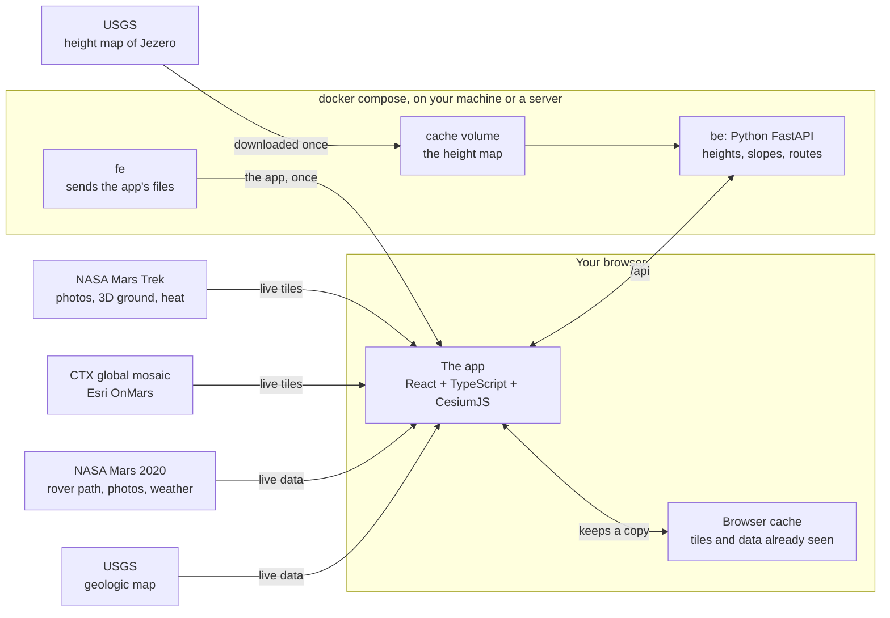

# Martian Map: Jezero Marswalk Planner

**NASA Space Apps 2026 · Challenge: Interplanetary Survival Guide: Martian Map · Team Red Compass**

A web map of Mars built on real NASA and USGS data. You go from space down to **Jezero Crater** (where the Perseverance rover landed), look at the ground in 2D and 3D, check any place, measure, read a briefing, and let the map **create several walking routes, check them and name the best one**.

> It is a **planning prototype**. It is not a navigation system for a real mission, and it never calls a route "safe".
>
> This file describes what works today. The decisions, their trade-offs and the status of every milestone are in [`PLAN.md`](PLAN.md) (start with its section 0).

**What is in it, in short**

| | |
|---|---|
| **Two screens** | A landing page, and the map at `/#/map` |
| **Views** | 2D (flat map) and 3D (the real planet, down to 25 m above the ground) |
| **Nine tools** | Layers · TOC · Briefing · Route · Measure · Place info · Go to · Sources · Legend |
| **Layers** | Photos (Viking, CTX, HiRISE) · the rover path · the USGS geologic map · night heat · a radiation estimate |
| **Backend** | Real heights and slopes of Jezero, routes, a walking-time map |

---

## Run it

You need **Docker Desktop**.

```bash
docker compose up --build
```

| Part | Address |
|---|---|
| Landing page (team Red Compass) | http://localhost:5173 |
| The map | http://localhost:5173/#/map |
| Backend health check | http://localhost:8000/api/health |
| Backend API docs | http://localhost:8000/docs |

Code changes show up live: the frontend reloads in the browser, and the backend restarts by itself.

No data is stored in this project. All images and 3D ground are loaded live from NASA services, so an internet connection is needed.

### Online for free

The steps to put the website on Vercel and the backend on a Hugging Face Space, both free, are in [`DEPLOY.md`](DEPLOY.md).

### A public link from this computer

To let other people open the app, start two more services. Your computer is the host: the link works while it is on and Docker is running.

```bash
docker compose --profile share up -d --build web tunnel
docker compose logs tunnel        # the https://....trycloudflare.com address is in here
docker compose --profile share down   # stop sharing
```

| Service | What it does |
|---|---|
| `web` | Builds the app and serves the finished files on http://localhost:4173. It is not the development server, so no source code is handed out |
| `tunnel` | Cloudflare's own tool (`cloudflared`). It gives this computer a public https address. No account is needed |

Things to know: the address is new every time the tunnel starts. Cloudflare gives no promise that a tunnel without an account stays up, and using it means you accept Cloudflare's terms. Anyone with the link can use the app and the route calculations, which run on this computer.

---

## The landing page

The first screen presents the idea of team **Red Compass**. Colours come from the team logo (navy `#0c1a3d`, red `#e8231f`, white) on black space.

| Part | What it is |
|---|---|
| 3D space scene | Three.js: Mars with the real NASA Viking colour mosaic (a sharper version loads in the background), an orange-red glow, two orbit rings, stars, and red rocks with a rough stone surface that tumble slowly (the rock surface is drawn by code, it is not a photo) |
| Top bar | Glass pills: "NASA Space Apps Challenge 2026" and the Red Compass mark, the section menu, and the "Open the map" button |
| Scroll story | Smooth scrolling (Lenis) + GSAP ScrollTrigger: the planet moves beside the text, turns to Jezero (red pin), then shows a START and a GOAL point with two winding routes |
| Sections | First screen · Mission (three steps, all built: see the planet, land in Jezero, plan the walk) · Data system (six sources from NASA and USGS) · Interface (the six tools of the map) · About Red Compass |
| Honesty | The two routes and the GOAL point on the globe are a drawing, and the page says so: the real routes are worked out in the map. The page calls the map a planning prototype, not a navigation system |
| Entry to the map | Every "Open the map" / "Launch application" button leads to `/#/map`. The compass mark in the map's top bar leads back |
| NASA logo | Not used. The NASA insignia needs NASA's permission. The event name is written as text |

The landing page and the map are loaded separately: the landing page does not download the map engine.

## What you can do now

| Feature | How |
|---|---|
| See Mars as a globe with NASA colour images | Opens like this |
| **Fly to Jezero** | Button at the top right. The camera first shows the whole crater from above. It waits there until the ground below is loaded (at most 4 seconds), then glides down to 1.5 km above the ground. The ground at the end of the flight is downloaded in advance, so it arrives sharp |
| **2D / 3D** | Buttons at the top right. 2D is a flat map, 3D is the real planet. Switching keeps the same place and about the same zoom. From 2D, 3D looks north at that place with a 45° tilt |
| **Tool bar** | A bar of icons at the left of the map. Each icon is one tool: a click opens its panel, a second click closes it. **Layers** (with the number of layers that are on), **Measure**, **Place info**, **Go to** (fly to Jezero, the landing site, the river delta, the west rim, the whole planet), **Sources** (where every piece of data comes from, with links) and **Legend** |
| **Route** | In the tool bar, in 2D and 3D. Choose a start and a goal (click the map, or pick a known place or a saved place). The backend **creates several routes, then checks them**: Shortest, Fastest (it knows uphill from downhill), Lower-slope, Flattest, Smooth ground (keeps away from bumpy ground and pits) and one clearly different way. Every route is measured the same way and gets a score from 0 to 100 (time 40%, steep ground 30%, climb 15%, bumpy ground 15%: our choice, shown in the panel). Routes that are nearly the same are joined, and a route that wins no measure is left out. The panel names the **best route with its reason**, lists the others best first, and for the chosen route shows the numbers, a height chart and a **Take care** list: steep ground, bumpy ground, pits, loose sand (from the USGS rock map), an estimate of the radiation during the walk, and a note when the walk is longer than one 8-hour spacewalk. **Walking-time map**: colours the whole of Jezero by how long it takes to walk there from the start (30 min, 1 h, 2 h, 4 h, 8 h rings). Lines are straightened, so they do not follow the grid. Walking time is an estimate and is labelled so. No route is called the safe route: the height map cannot see rocks, dust storms or solar storms. Routes exist inside the height map of Jezero only: that area is drawn on the map as a dashed box with a label, a click outside it is refused with a message, and "Show the box" flies to it |
| **Briefing** | In the tool bar. A dashboard for the astronaut, "before you go outside": the weather at Jezero from NASA's public feed of the Perseverance rover's weather station (night and day air temperature, air pressure, season, a small chart of the last readings), daylight (sunrise and sunset), radiation (0.64 mSv per day, measured by the Curiosity rover, used as an estimate), dust storm season (from where Mars is in its year), loose sand, gravity. Each card says where its number comes from. The page says clearly what is not known: the weather feed's newest reading is from April 2024, and it has no wind and no dust numbers, so none are shown |
| **Measure** | In the tool bar, in 2D and 3D. Choose what to measure: **Distance** (a line through your points) or **Area** (a closed shape: its area and the distance around it). Click to add points: a dashed line follows the mouse and a note at the cursor shows the numbers. Double click (or Esc, Enter, a click on the last point, or the Finish button) finishes, and the next click starts a new one. Drag a point to move it, right click it or use the bin to delete it, Backspace removes the last point. In 3D the line lies on the ground and follows hills. **Settings** (the gear): two dropdowns with a search box, one for the distance unit (metres, kilometres, feet, yards, miles, nautical miles, or automatic) and one for the area unit (m², hectares, km², ft², acres, mi², or automatic). Type a few letters to find a unit. The choice is kept in the browser. Closing the tool hides its drawing, and opening it again brings it back. Distances and areas are over the Mars sphere (radius 3,396.19 km): the ups and downs of the ground are not counted, and the panel says so. The drawing interaction is shared code (`lineDraw.ts`) for any line tool |
| **Place info** | In the tool bar, in 2D and 3D (the code calls it identify). Click any place. Each card is a plain question (How high is it? How steep is it? What is the ground made of?) with one sentence, one picture and a "What is this?" line for the longer explanation. The panel shows the place, three numbers to read at a glance (height, slope, rock type), then one card per fact with a small chart: **height** on a scale from the lowest to the highest ground of Jezero, with the landing site marked, **shape of the ground** (a 1 km cut from west to east through the place), **slope** on a band scale, and the **rock type** from the USGS geologic map. Height and slope are real numbers from the USGS height map of Jezero (20 m per pixel), worked out by our backend. **Real look:** within 300 m of the rover path it shows photos the rover took on that Mars day (NASA Mars 2020 raw images, mast camera and navigation camera). A click opens a photo viewer with arrows, thumbnails and zoom. A fact that does not exist at the place says so. **Save as waypoint** keeps the place: waypoints stay on the map, can be flown to and deleted, and are kept in the browser |
| **TOC** | In the tool bar. The table of contents of the map: only the layers that are switched on, in their groups. Open a layer to see what its colours and lines mean, or close it to keep the list short (also "Open all" and "Close all"). The eye hides a layer on the map and shows it again: the layer stays in the TOC (greyed, marked Hidden), and while hidden it is not in the Legend. Inside a layer, every legend entry has its own eye too: hide one rock unit, only the river channels, or only the rover marker, and the rest of the layer stays (with "Show all" and "Hide all"). Hidden entries leave the Legend as well. Layers are added and removed in Layers. Layers, TOC and Legend share one record, so they always agree |
| **Fold a panel** | Every panel has an arrow in its heading that folds it to the heading only, so the map is free. The panels at the left fold upwards, the legend at the bottom folds downwards. A folded tool keeps working and keeps what it holds |
| **Layers** | In the tool bar. Switch layers on and off, and set how strong an overlay is. **Perseverance path**: every drive of the rover since landing, loaded live from NASA's Mars 2020 mission map (the panel shows the number of drives, the distance and the last Mars day). **Cosmic radiation (estimate)**: a heat map of the whole planet, blue = less, red = more. It is an estimate, not a measurement: it recolours NASA's MOLA elevation map with the method of NASA's 2002 map "Estimated Radiation Dosage on Mars" (PIA03480): low ground has more air above it, so less cosmic radiation (about 10 rem per year in the lowest places, about 20 on the highest). The panel says this next to the layer. **Night heat**: THEMIS infrared, bright = warm rock, dark = cold dust. **Ultra-detail photos** (HiRISE) and **Detail photos** (CTX) can be switched off too. **Geologic map of Jezero** (USGS map SIM 3464, Sun and Stack 2020), read live from the USGS service, each part with its own switch: geologic units (14 kinds of rock, in the USGS colours, with a colour key), geologic contacts, linear features (river channels, crater rims, delta fronts), surface features, location features, cross sections, map boundary and the landing ellipse |
| **Legend** | In the tool bar. A card at the bottom right of the map. It explains everything drawn on the map right now: the landing site marker, and the colours and lines of every layer that is switched on. Every entry has one plain sentence that says what it is (for the rock units: a short version of the USGS interpretation). It changes by itself when you switch layers. It can be folded away. In the Layers panel, each group (Mission, Radiation and heat, Geologic map, Photos) folds with a click on its heading, which also shows how many of its layers are on |
| Go down to the surface | Zoom in to 25 m above the ground. Near the ground the sky turns Mars-coloured |
| Coordinates under the mouse | Bottom left (latitude and longitude, on the 3D ground) |
| Map controls | Bottom right: zoom in and out (smooth, grey out at the limits), compass (click to face north), whole planet, fullscreen |
| Status | Bottom bar: map tiles (loading or ready), 3D ground source and backend connection |

### Mouse controls

| | 3D near the ground (below 300 km) | 3D far away (globe) | 2D |
|---|---|---|---|
| **Drag** | Move over the ground. The point you grab stays under the cursor, with a short glide when you let go | Spin the planet | Move the map |
| **Ctrl + drag** or **middle drag** | Right / left turns the view around the screen centre. Up tilts towards the horizon, down tilts towards a top view | Tilt | Nothing: the flat map always keeps north up |
| **Drag on the sky** | Look around in place | | |
| **Wheel** | Zoom | Zoom | Zoom |

A short reminder of these is shown in the bottom bar.

### Limits (so the view never breaks)

| View | Closest | Furthest | Other |
|---|---|---|---|
| 3D | 25 m above the ground inside the HiRISE area (25 cm photos). 250 m elsewhere, where the best photos are 6 m per pixel and a closer view would only show blur | 25,000 km | Tilt from straight down to 15° above the horizon |
| 2D | 1 km across | The whole map | The map always fills the screen. Edges stop at the screen edge. At the widest zoom the map does not slide at all |

---

## Data in use (all live, nothing stored)

Everything is loaded from public services at the moment you look at it. No data file is in this repository.

| What | Source | Detail | Used for |
|---|---|---|---|
| Colour globe | NASA Mars Trek, Viking colour mosaic | 232 m | The planet from far away |
| Jezero region photos | NASA Mars Trek, CTX mosaic, aligned (`Jezero_CTX_BlockAdj_dd`) | about 6 m | Near Jezero |
| Rest of Mars, close up | CTX global mosaic (Caltech Murray Lab, served by Esri) | about 5 m | Near the ground outside Jezero |
| Very close detail | NASA Mars Trek, HiRISE mosaic | 25 cm | Below about 3 km, near the landing site |
| 3D ground | NASA Mars Trek terrain service | down to 1 to 2 m near the landing site, about 330 m far from it | The shape of the land on screen |
| Night heat | NASA Mars Trek, THEMIS infrared | 100 m | The "Night heat" layer |
| Elevation of the planet | NASA Mars Trek, MOLA | about 1.3 km | The radiation estimate layer |
| **Height map of Jezero** | USGS, Mars 2020 TRN, CTX DTM | **20 m** | Real heights, slopes and every route (read by the backend) |
| **Geologic map of Jezero** | USGS map SIM 3464 (Sun and Stack, 2020), feature service | 1:75,000 | Rock units, contacts, river channels, loose sand |
| Rover path | NASA Mars 2020 mission map | every drive | The "Perseverance path" layer |
| Rover photos | NASA Mars 2020 raw images | per Mars day | "Real look" in Place info |
| Weather at Jezero | NASA Mars 2020 weather feed (rover station MEDA) | per Mars day, newest reading 27 April 2024 | Briefing |
| Radiation, 0.64 mSv per day | Curiosity rover measurement (Hassler et al., 2014), used as an estimate | one number | Briefing and routes |

**About the colours:** CTX and HiRISE are black-and-white cameras. They are tinted to Mars colours so they match the colour globe. This changes the look only, never a measurement.

**About heights:** Trek's 3D ground uses its own height zero (about +5.6 km at Jezero instead of the real −2.6 km). It is right for the shape of the land, so it is used for drawing only. Every height the app shows as a number comes from the USGS height map. Checked: the landing site reads −2567.5 m, and NASA's own rover data says −2569.9 m.

**About estimates:** the radiation layer, the radiation dose of a walk and the walking time are estimates. The app labels each of them as an estimate and says what it is based on.

---

## How it is built



**How to read it.** The app runs inside your browser. Docker only sends its files and runs the calculator (the backend). Map pictures and data come straight from NASA and USGS to the browser. The browser keeps a copy of what it has seen: map tiles are reused at once, and the small data files (rover path, weather, geologic map) are used from the copy when a NASA or USGS server does not answer. The backend downloads the USGS height map once and keeps it in a Docker volume. Nothing is stored in the repository.

### The stack

| Part | Technology |
|---|---|
| Website | React 19, TypeScript, Vite 8 |
| UI | **Chakra UI 3** (theme in `src/theme.ts`), **Lucide** icons, font Inter. Colours from the Red Compass logo: navy `#0c1a3d`, red `#e8231f` |
| Map engine | **CesiumJS 1.147**: one viewer, Mars as a sphere with radius 3,396,190 m (the same as NASA's data). No Cesium ion, no paid keys |
| Landing page | Three.js, GSAP with ScrollTrigger, Lenis (smooth scrolling), font Unbounded |
| Photo viewer | yet-another-react-lightbox |
| Backend | Python 3.12, FastAPI, uvicorn |
| Maths | numpy, rasterio (reads the height map), scikit-image (`MCP_Geometric` least-cost path), scipy, Pillow |
| Running | Docker Compose: `fe`, `be`, and a cache volume for the height map |
| Tests | pytest: 74 backend tests on small made-up grids |

### What the backend answers

| Address | Answer |
|---|---|
| `GET /api/health` | The backend is running |
| `GET /api/dem/info` | The height map: ready or loading, its edges, its source |
| `GET /api/point?lon=&lat=` | Height and slope of one place, the height range of Jezero, a 1 km cut through the ground |
| `GET /api/routes?from_lon=&from_lat=&to_lon=&to_lat=` | Several routes, measured, scored and ranked, with the best one and the reason |
| `GET /api/route?…` | The first version with two routes. Still there, no longer used by the app |
| `GET /api/reach?lon=&lat=` | The walking time from one start to every place of Jezero, as a picture with a legend |

The interactive list is at http://localhost:8000/docs when the app runs.

### Main files

```
frontend/src/
├─ Root.tsx                    chooses the screen: landing page or map (/#/map)
├─ App.tsx                     the map screen: top bar, tool bar, map, status bar
├─ theme.ts                    Chakra theme (logo colours)
├─ landing/
│  ├─ Landing.tsx              the landing page (scroll story, sections)
│  └─ MarsScene.ts             the 3D Mars of the landing page (Three.js)
├─ globe/                      everything that touches the map
│  ├─ MarsViewer.tsx           Cesium viewer, camera limits, fly to Jezero, 2D / 3D
│  ├─ mars.ts                  Mars sphere, landing site, terrain address
│  ├─ groundControls.ts        mouse controls in 3D near the ground
│  ├─ trekTerrain.ts           Trek 3D ground, with a fix for its tile bounds
│  ├─ preload.ts               downloads the tiles of a place before the camera gets there
│  ├─ layers.config.ts         the list of layers and of the rows in the Layers panel
│  ├─ imagery.ts · tint.ts     builds the photo layers, tints grey photos to Mars colours
│  ├─ pathLayer.ts             the rover path, painted as map tiles
│  ├─ geologyLayer.ts          the USGS geologic map, painted as map tiles
│  ├─ radiation.ts             the radiation estimate layer
│  ├─ layerControl.ts          shows and hides layers on the map
│  ├─ layerState.ts            one record of which layers are on (Layers, TOC and Legend share it)
│  ├─ mapTools.ts              helpers for the tools: pick a place, distances, cursors
│  ├─ lineDraw.ts · measure.ts drawing a line by hand, and the Measure tool on top of it
│  ├─ identify.ts              Place info: the facts of a place, saved places
│  ├─ route.ts                 Route: asks the backend, draws the routes, the route area
│  ├─ weather.ts               reads NASA's weather feed for the Briefing
│  └─ units.ts                 the units setting
└─ ui/                         the panels
   ├─ Sidebar.tsx              the tool bar, the panel card, Go to, Sources
   ├─ LayersPanel.tsx · TocPanel.tsx · MapLegend.tsx
   ├─ RoutePanel.tsx · MeasurePanel.tsx · UnitPicker.tsx
   ├─ IdentifyPanel.tsx · IdentifyCharts.tsx   (Place info)
   ├─ BriefingPanel.tsx
   └─ MapControls.tsx · CompassStar.tsx
backend/app/
├─ main.py                     the API
├─ dem.py                      downloads and reads the height map, height and slope of a point
├─ terrain.py                  roughness and pits from the height map
├─ routing.py                  least-cost path, the first two routes
├─ candidates.py               several routes: create, measure, score, rank, explain
└─ reach.py                    the walking-time map
backend/tests/                 74 tests
docker-compose.yml             runs both parts
PLAN.md                        the plan, decisions and status
CLAUDE.md                      notes for AI coding sessions
```

---

## Problems found and fixed

These are worth knowing if you change the map code. Details are in `PLAN.md` (section 12) and `.claude/skills/cesium-mars/SKILL.md`.

| Problem | Cause | Fix |
|---|---|---|
| Holes and cut strips in the 3D ground | Trek's terrain tiles carry position boxes made for another planet shape | Each tile's box is rebuilt for our Mars sphere (`trekTerrain.ts`) |
| Craters cut in half, horizontal bands | Tinted tiles were drawn upside down inside their own square | The tint returns tiles in the same form Cesium loads them (`tint.ts`) |
| Patchy colours | Several photo mosaics stacked at the same zoom | One seamless source per zoom range |
| Sunlit slopes turned white | The tint kept each pixel's brightness, and very bright pixels can't hold colour | The photo is multiplied by a light Mars tan, like a colour filter: the brightest result is tan, never white (`tint.ts`) |
| Dragging in 3D moved the wrong way, the ground slid under the cursor | Cesium's drag grabs the smooth sphere, 5.6 km below Trek's ground. A first own version only estimated the movement (up to 150 px off) | Own controls with exact geometry: 0 px error in tests (`groundControls.ts`) |
| Map stopped drawing ("not a number" error), camera went through the ground | The 2.5D mode (a tilted flat map): Cesium's tilt and ground checks do not work well there with this terrain | 2.5D removed (it showed the same as 3D near the ground). Safe camera rules and an error safety net stay |
| Blurry ground for seconds after "Fly to Jezero" | Cesium only loads the tiles it sees now, one detail level after the other | The tiles of the destination are downloaded in advance, and the camera waits above the crater until they are in (`preload.ts`) |

## Speed: how much the map loads

Measured on 2026-11-14 for the Jezero arrival view (1.5 km above the ground, looking at the horizon):

| | Tile requests | Time until the view is complete |
|---|---|---|
| Before | 1,400 | 2.4 s |
| **Now** | **675** | **1.4 s** |

The picture is the same. What changed:

| Change | Why it helps |
|---|---|
| No preloading of neighbour tiles | About 400 requests were for tiles off screen |
| The global CTX layer is not downloaded where the Jezero mosaic covers it | It was a third of all downloads, for pixels nobody sees |
| Coarser tiles for far ground near the horizon | Far ground covers few pixels, it does not need fine tiles |
| Lighter detail while the camera moves, full detail about half a second after it stops | Dragging keeps up with the mouse |
| Tiles for a flight are downloaded before the camera arrives | No blurry arrival (`preload.ts`) |
| **Permanent tile cache** in the browser (`public/tile-cache-sw.js`) | NASA's servers make the browser ask again for every tile on every visit. A tile is now stored after its first download and answered at once after that, also after a reload (up to 6,000 tiles) |
| **Look-around preload** | When the camera rests near the ground, the nearest tiles to the left, right and behind are fetched, so turning does not wait for the network |

## Known limits

- **It is a prototype for planning**, not a navigation system. No route is called safe.
- **Routes, heights and slopes exist inside the Jezero height map only.** The Route tool shows that area as a dashed box.
- **The height map has one value every 20 m.** It cannot see rocks, small holes, dust storms or solar storms. "Bumpy ground" and "pits" mean bumps and dips at that scale.
- **The weather is not today's.** NASA's public feed stops at 27 April 2024, and it has no wind and no dust numbers. The Briefing shows the date and does not guess the missing numbers.
- **Radiation is one number for all of Jezero**, measured by the Curiosity rover in another crater. The radiation layer is an estimate from ground height.
- **Walking time is an estimate.** The space suit factor and the slope rule are assumptions, listed in the Route panel.
- **Photos limit the detail near the ground**: 25 cm only near the landing site, about 6 m elsewhere. Faint lines can show where two photo strips meet in NASA's own mosaics.
- **Far from Jezero the 3D ground is coarse** (one height about every 330 m), so the photo can show shadows where the ground model is smooth.
- **The app depends on outside servers** (NASA Mars Trek, NASA Mars 2020, USGS, Esri). Map tiles and the small data files are kept in the browser after the first visit, so a server that is down for a moment does not break those layers. A first visit still needs every server, and rover photos are not kept.
- **Trek's terrain service is not a documented public API.** If it changes, the 3D ground falls back to a smooth sphere.
- **Not built from the plan:** the intro fly-in, the mineral (CRISM) layers, contour lines and slope colours, swipe compare. Not tested: phone-size screens.

---

## Credits

- Photos, 3D ground, night heat and elevation of the planet: **NASA/JPL-Caltech Mars Trek**.
- CTX global mosaic: **NASA/JPL/MSSS, Caltech Murray Lab, Esri**.
- Height map of Jezero and the geologic map SIM 3464 (Sun and Stack, 2020): **USGS Astrogeology**.
- Rover path, rover photos and weather: **NASA/JPL-Caltech, Mars 2020 mission**.
- Radiation per day: **Curiosity rover, RAD instrument** (Hassler et al., Science, 2014).
- Map engine: **CesiumJS** (Apache-2.0). Interface rules: Vercel Web Interface Guidelines (MIT).
- Built by team **Red Compass** for the NASA Space Apps Challenge 2026. The code is under the MIT license (see `LICENSE`).
