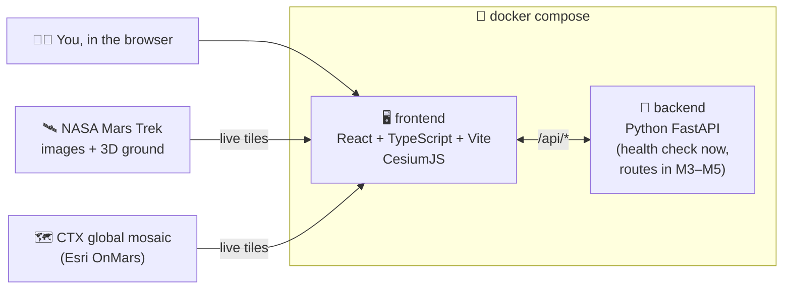

# Martian Map: Jezero Marswalk Planner

**NASA Space Apps 2026 · Challenge: Interplanetary Survival Guide: Martian Map**

A web map of Mars built on real NASA data. You can fly from space down to **Jezero Crater** (where the Perseverance rover landed), switch between 2D and 3D, and go down to 25 m above the ground to look at the crater floor, the river delta and the horizon.

> **This file describes what works today.** The full plan, every decision with its trade-offs, and the next milestones are in [`PLAN.md`](PLAN.md).

**Status:** Milestone **M0 done** (map foundation). Next: **M1**, the intro fly-in. Routes are planned for M3 to M5.

---

## Run it

You need **Docker Desktop**.

```bash
docker compose up --build
```

| Part | Address |
|---|---|
| Landing page (team Red Compass) | http://localhost:5173 |
| The map | http://localhost:5173/#/map |
| Backend health check | http://localhost:8000/api/health |
| Backend API docs | http://localhost:8000/docs |

Code changes show up live: the frontend reloads in the browser, and the backend restarts by itself.

No data is stored in this project. All images and 3D ground are loaded live from NASA services, so an internet connection is needed.

---

## The landing page

The first screen presents the idea of team **Red Compass**. Colours come from the team logo (navy `#0c1a3d`, red `#e8231f`, white) on black space.

| Part | What it is |
|---|---|
| 3D space scene | Three.js: Mars with the real NASA Viking colour mosaic (a sharper version loads in the background), an orange-red glow, two orbit rings, stars, and red rocks with a rough stone surface that tumble slowly (the rock surface is drawn by code, it is not a photo) |
| Top bar | Glass pills: "NASA Space Apps Challenge 2026" and the Red Compass mark, the section menu, and the "Open the map" button |
| Scroll story | Smooth scrolling (Lenis) + GSAP ScrollTrigger: the planet moves beside the text, turns to Jezero (red pin), then shows a START and a GOAL point with two winding routes |
| Sections | First screen · Mission (three steps) · Data system (four NASA sources) · Interface · About Red Compass |
| Honesty | Route planning is marked **Coming next**. The two routes and the GOAL point on the globe are an illustration, not calculated routes |
| Entry to the map | Every "Open the map" / "Launch application" button leads to `/#/map`. The compass mark in the map's top bar leads back |
| NASA logo | Not used. The NASA insignia needs NASA's permission. The event name is written as text |

The landing page and the map are loaded separately: the landing page does not download the map engine.

## What you can do now

| Feature | How |
|---|---|
| See Mars as a globe with NASA colour images | Opens like this |
| **Fly to Jezero** | Button at the top right. The camera first shows the whole crater from above. It waits there until the ground below is loaded (at most 4 seconds), then glides down to 1.5 km above the ground. The ground at the end of the flight is downloaded in advance, so it arrives sharp |
| **2D / 3D** | Buttons at the top right. 2D is a flat map, 3D is the real planet. Switching keeps the same place and about the same zoom. From 2D, 3D looks north at that place with a 45° tilt |
| **Layers** | Button at the top left of the map. Switch layers on and off, and set how strong an overlay is. **Perseverance path**: every drive of the rover since landing, loaded live from NASA's Mars 2020 mission map (the panel shows the number of drives, the distance and the last Mars day). **Night heat**: THEMIS infrared, bright = warm rock, dark = cold dust. **Ultra-detail photos** (HiRISE) and **Detail photos** (CTX) can be switched off too. **Geologic map of Jezero** (USGS map SIM 3464, Sun and Stack 2020), read live from the USGS service, each part with its own switch: geologic units (14 kinds of rock, in the USGS colours, with a colour key), geologic contacts, linear features (river channels, crater rims, delta fronts), surface features, location features, cross sections, map boundary and the landing ellipse |
| Go down to the surface | Zoom in to 25 m above the ground. Near the ground the sky turns Mars-coloured |
| Coordinates under the mouse | Bottom left (latitude and longitude, on the 3D ground) |
| Map controls | Bottom right: zoom in and out (smooth, grey out at the limits), compass (click to face north), whole planet, fullscreen |
| Status | Bottom bar: map tiles (loading or ready), 3D ground source and backend connection |

### Mouse controls

| | 3D near the ground (below 300 km) | 3D far away (globe) | 2D |
|---|---|---|---|
| **Drag** | Move over the ground. The point you grab stays under the cursor, with a short glide when you let go | Spin the planet | Move the map |
| **Ctrl + drag** or **middle drag** | Right / left turns the view around the screen centre. Up tilts towards the horizon, down tilts towards a top view | Tilt | Nothing: the flat map always keeps north up |
| **Drag on the sky** | Look around in place | | |
| **Wheel** | Zoom | Zoom | Zoom |

A short reminder of these is shown in the bottom bar.

### Limits (so the view never breaks)

| View | Closest | Furthest | Other |
|---|---|---|---|
| 3D | 25 m above the ground inside the HiRISE area (25 cm photos). 250 m elsewhere, where the best photos are 6 m per pixel and a closer view would only show blur | 25,000 km | Tilt from straight down to 15° above the horizon |
| 2D | 1 km across | The whole map | The map always fills the screen. Edges stop at the screen edge. At the widest zoom the map does not slide at all |

---

## Data in use (all live from NASA, nothing stored)

| What you see | Source | Detail | Used when |
|---|---|---|---|
| Colour globe | NASA Mars Trek, Viking colour mosaic | 232 m | Far away |
| **Jezero region** | NASA Mars Trek, CTX mosaic, aligned (`Jezero_CTX_BlockAdj_dd`) | ~6 m | Near Jezero |
| Rest of Mars, close up | CTX global mosaic (Caltech Murray Lab, via Esri) | ~5 m | Near the ground outside Jezero |
| Very close detail | NASA Mars Trek, HiRISE mosaic | 25 cm | Below about 3 km, crater centre only |
| 3D ground | NASA Mars Trek terrain service | Down to ~1–2 m | Always |

**About the colours:** CTX and HiRISE are black-and-white cameras. They are tinted to Mars colours so they match the colour globe. This changes the look only, never a measurement.

**About heights:** Trek's 3D ground uses its own height zero (about +5.6 km at Jezero instead of the real −2.5 km). It is correct for the shape of the land. Real heights for routes will come from the USGS elevation model in the backend (M3).

---

## How it is built



| Part | Technology |
|---|---|
| Map engine | CesiumJS 1.147, one viewer, Mars as a sphere with radius 3,396,190 m (same as NASA's data) |
| Screen | React 19, TypeScript, Vite, **Chakra UI 3** (theme in `src/theme.ts`), **Lucide** icons. Clean NASA website style |
| Backend | Python 3.12, FastAPI |
| Running | Docker Compose (`fe` and `be`) |

### Main files

```
frontend/src/
├─ Root.tsx                    chooses the screen: landing page or map (/#/map)
├─ landing/Landing.tsx         the landing page (Chakra + GSAP scroll story)
├─ landing/MarsScene.ts        the 3D Mars of the landing page (Three.js)
├─ theme.ts                    Chakra theme
├─ App.tsx                     the map screen: top bar, status bar, view-mode buttons
├─ globe/
│  ├─ MarsViewer.tsx           Cesium viewer, camera limits, fly to Jezero, Mars sky
│  ├─ mars.ts                  Mars sphere, landing site, terrain address
│  ├─ layers.config.ts         the list of map layers (one entry per layer)
│  ├─ imagery.ts               builds the layers from that list
│  ├─ tint.ts                  Mars colour tint for black-and-white photos
│  ├─ trekTerrain.ts           Trek 3D ground, with a fix for its tile bounds
│  ├─ groundControls.ts        mouse controls in 3D near the ground
│  └─ preload.ts               downloads the tiles of a place before the camera gets there
└─ ui/MapControls.tsx          zoom, compass, whole planet, fullscreen
backend/app/main.py            FastAPI app (/api/health)
docker-compose.yml             runs both parts
PLAN.md                        the plan, decisions and trade-offs
CLAUDE.md                      notes for AI coding sessions
```

---

## Problems found and fixed

These are worth knowing if you change the map code. Details are in `PLAN.md` (section 12) and `.claude/skills/cesium-mars/SKILL.md`.

| Problem | Cause | Fix |
|---|---|---|
| Holes and cut strips in the 3D ground | Trek's terrain tiles carry position boxes made for another planet shape | Each tile's box is rebuilt for our Mars sphere (`trekTerrain.ts`) |
| Craters cut in half, horizontal bands | Tinted tiles were drawn upside down inside their own square | The tint returns tiles in the same form Cesium loads them (`tint.ts`) |
| Patchy colours | Several photo mosaics stacked at the same zoom | One seamless source per zoom range |
| Sunlit slopes turned white | The tint kept each pixel's brightness, and very bright pixels can't hold colour | The photo is multiplied by a light Mars tan, like a colour filter: the brightest result is tan, never white (`tint.ts`) |
| Dragging in 3D moved the wrong way, the ground slid under the cursor | Cesium's drag grabs the smooth sphere, 5.6 km below Trek's ground. A first own version only estimated the movement (up to 150 px off) | Own controls with exact geometry: 0 px error in tests (`groundControls.ts`) |
| Map stopped drawing ("not a number" error), camera went through the ground | The 2.5D mode (a tilted flat map): Cesium's tilt and ground checks do not work well there with this terrain | 2.5D removed (it showed the same as 3D near the ground). Safe camera rules and an error safety net stay |
| Blurry ground for seconds after "Fly to Jezero" | Cesium only loads the tiles it sees now, one detail level after the other | The tiles of the destination are downloaded in advance, and the camera waits above the crater until they are in (`preload.ts`) |

## Speed: how much the map loads

Measured on 2026-11-14 for the Jezero arrival view (1.5 km above the ground, looking at the horizon):

| | Tile requests | Time until the view is complete |
|---|---|---|
| Before | 1,400 | 2.4 s |
| **Now** | **675** | **1.4 s** |

The picture is the same. What changed:

| Change | Why it helps |
|---|---|
| No preloading of neighbour tiles | About 400 requests were for tiles off screen |
| The global CTX layer is not downloaded where the Jezero mosaic covers it | It was a third of all downloads, for pixels nobody sees |
| Coarser tiles for far ground near the horizon | Far ground covers few pixels, it does not need fine tiles |
| Lighter detail while the camera moves, full detail about half a second after it stops | Dragging keeps up with the mouse |
| Tiles for a flight are downloaded before the camera arrives | No blurry arrival (`preload.ts`) |
| **Permanent tile cache** in the browser (`public/tile-cache-sw.js`) | NASA's servers make the browser ask again for every tile on every visit. A tile is now stored after its first download and answered at once after that, also after a reload (up to 6,000 tiles) |
| **Look-around preload** | When the camera rests near the ground, the nearest tiles to the left, right and behind are fetched, so turning does not wait for the network |

## Known limits

- Close to the ground the detail is limited by NASA's photos (25 cm only near the landing site, about 6 m elsewhere). Rocks smaller than about half a metre are not in the data.
- Faint lines can show where two photo strips meet in NASA's own mosaics.
- Trek's terrain service is not a documented public API. If it changes, the 3D ground falls back to a smooth sphere.

---

## Credits

Images and 3D ground: **NASA/JPL-Caltech Mars Trek**. CTX global mosaic: **NASA/JPL/MSSS, Caltech Murray Lab, Esri**. Elevation model (planned for routes): **USGS Astrogeology**, Mars 2020 landing products. Map engine: **CesiumJS** (Apache-2.0).
